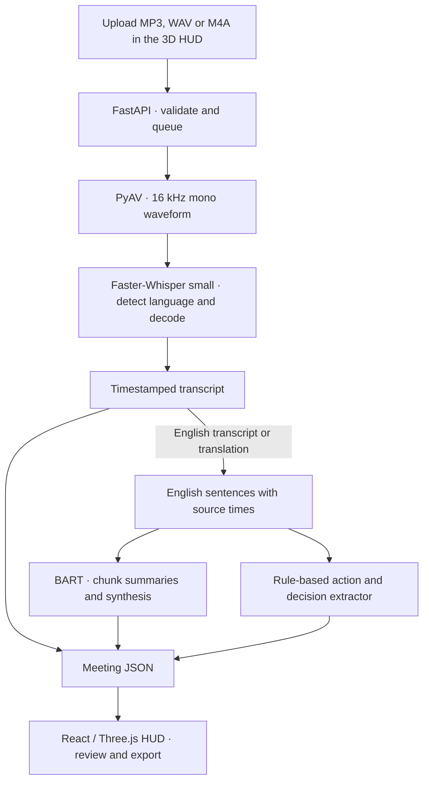

# Scribe.ai — Multilingual Meeting Scribe

Turn a meeting recording into a timestamped transcript, an English brief and a list of decisions and assignments, all on your own computer.


[Deep learning architecture](#deep-learning-architecture) · [Run locally](#run-locally) · [Evaluation](#evaluation) · [First GitHub upload](#first-github-upload)

## Overview

A recording preserves what people said, but finding who agreed to send a draft or when a deadline changed can mean replaying the whole meeting. Scribe.ai pairs a concise brief with timestamped source segments. Its React and Three.js interface lets you follow processing, review the evidence for an action or decision, and export notes as TXT, subtitles as SRT or the full result as JSON.

Setup requires internet access once for packages and weights. After that, the browser sends recordings to FastAPI on loopback, and both neural networks run locally. No account, paid API or cloud inference service is required. The backend closes upload spools after each job and keeps recent results in memory. Files you export remain on your device.

| Choose in the UI | Transcript | Summary, actions and decisions |
|---|---|---|
| **Transcribe in original language** | Timestamped speech in the detected language | Available for English. Other languages retain their transcript. |
| **Translate to English** | Timestamped English text produced directly from speech by Whisper | Available for the English output. Source-language detection is still reported. |

## Deep learning architecture

### 1. From waveform to words · multilingual Whisper small

PyAV decodes the first audio stream, resamples it to **16 kHz mono** and converts the signed 16-bit samples to a normalized float32 waveform. The engine skips digital silence, applies bounded gain to quiet recordings and enables voice activity detection before recognition. Whisper converts the audio to log-Mel features. Its Transformer encoder learns representations of acoustic context, and its autoregressive decoder attends to those representations and preceding text tokens to predict the next token. Task tokens let the same pretrained network transcribe speech or translate it into English. [Whisper architecture and tasks](https://github.com/openai/whisper)

The backend returns the detected source language, its probability and segment start/end times. The probability describes the language choice. Individual words can still be wrong. Production decoding uses **beam_size=5**, retaining up to five candidate continuations as the decoder searches for a high-scoring sequence. Wider search costs time. The evaluation below measures what that extra work bought on the supplied clips. [Inference implementation](backend/engine.py)

### 2. Inference optimization · CTranslate2 and precision

Faster-Whisper runs converted Whisper weights with CTranslate2. This gives the ASR stage optimized inference kernels and a CPU quantization path, while BART uses PyTorch. On startup, `SCRIBE_DEVICE=auto` checks `torch.cuda.is_available()` and selects the following configuration. [Faster-Whisper runtime and hardware support](https://github.com/SYSTRAN/faster-whisper)

| Device | Whisper via CTranslate2 | BART via PyTorch | Engineering rationale |
|---|---|---|---|
| CUDA GPU | FP16 | FP16 | Half-precision weights reduce GPU memory use and suit supported GPU kernels. |
| CPU | INT8 | FP32 | Quantized Whisper weights reduce memory traffic and enable integer kernels. BART keeps standard CPU floating-point execution. |

The server keeps one copy of each model resident and serializes inference. Up to three uploads/jobs can be admitted, including the active one. A fourth receives HTTP 429. This bounds concurrent memory demand. Available RAM or VRAM still limits the workload. [API worker](backend/main.py)

### 3. Abstractive summaries · BART and a bounded context window

BART is a sequence-to-sequence Transformer pretrained as a **denoising autoencoder**. A bidirectional encoder reads corrupted text and an autoregressive decoder learns to reconstruct the original. The `facebook/bart-large-cnn` checkpoint was then fine-tuned on English CNN/DailyMail summaries. Here, it can merge related points expressed in different parts of a conversation and phrase them concisely. An extractor that copies the first few sentences can miss the outcome entirely. Generated wording can also introduce errors, which is why the interface preserves the transcript. [BART model card](https://huggingface.co/facebook/bart-large-cnn)

| Step | What the implementation does |
|---|---|
| Short input | Returns English transcripts under 15 whitespace-separated words verbatim. |
| Pack | Counts tokenizer IDs including the pipeline prefix and special tokens. Packs complete sentences within the **1,024-token** encoder limit, splitting an oversized sentence when necessary. |
| Map | Generates one summary per chunk. The maximum output length is half the encoded input length, rounded down and bounded to 4–142 tokens. The minimum is half that maximum, rounded down and capped at 30. |
| Reduce | Packs the partial summaries and summarizes them again, repeating until one summary remains. For multi-window input, a final safeguard appends timestamped evidence for the latest explicitly worded decision if its wording is missing. |

This map-reduce approach covers recordings longer than a single BART input window. Each compression pass can discard context, particularly a qualification or reversal. [Summary implementation](backend/insights.py)

### 4. Evidence-backed action items and decisions

The extractor reads **English transcript sentences** and preserves their source segment times. A rule matching “Maya will send the draft by Friday” can return an action with owner `Maya` and due phrase `Friday`. “We agreed to release on Monday” matches a decision. Missing owners and dates remain null. Working from the transcript also preserves assignments omitted by BART. The rules add no third set of model weights and therefore reduce memory pressure and OOM risk on consumer hardware. [Extraction rules](backend/insights.py)

### 5. Zero-shot transfer and local model persistence

Scribe.ai applies pretrained speech and summarization models to meetings **without project-specific training**. This is zero-shot transfer to the meeting domain. BART already received supervised summarization training upstream. The downloader fetches pinned model revisions, verifies the content digests of ten required files and stores the converted Whisper `model.bin`, BART `model.safetensors` and their tokenizer/configuration files under the root `models/` directory. Runtime loaders use local paths with `local_files_only=True`, and the backend enables Hugging Face offline mode. [Downloader](backend/download_models.py) · [Pinned revisions](backend/model_versions.py)

## System architecture



## Tech stack

| Layer | Components | Role |
|---|---|---|
| Deep learning | Faster-Whisper, CTranslate2, PyTorch, Hugging Face Transformers | Speech recognition, translation, quantized inference and summary generation |
| Backend | Python 3.12, FastAPI, Uvicorn, PyAV, NumPy, Pydantic | Audio decoding, job lifecycle and typed results |
| 3D frontend | React 18, Three.js, React Three Fiber, Drei, Framer Motion, Vite | Upload, processing animation, transcript review and export |
| Prototyping and evaluation | Python scripts, FLEURS and AMI references | Reproducible local scoring. A Colab notebook is optional and is not part of this checkout. |

## Repository layout

The Vite frontend lives at the repository root. Run npm commands beside `package.json`. The tree shows source and evaluation files plus the generated model cache.

```text
.
├── backend/
│   ├── main.py                  # FastAPI endpoints and job queue
│   ├── engine.py                # Audio decoding, model loading and inference
│   ├── insights.py              # BART chunking and sentence-level extraction
│   ├── download_models.py
│   ├── model_versions.py
│   ├── requirements.txt
│   └── test_regressions.py
├── src/                         # React / Three.js frontend
│   ├── App.jsx
│   ├── MeetingResults.jsx
│   ├── NeuralScene.jsx
│   ├── WebGLScene.jsx
│   ├── main.jsx
│   ├── orbGeometry.js
│   ├── processMeetingAudio.js
│   ├── styles.css
│   └── useMeetingJob.js
├── public/                      # Local icons and textures
├── evaluation/
│   ├── REPORT.md
│   ├── actions.json
│   ├── manifest.json
│   ├── results.json
│   ├── prepare.py
│   ├── reversal.py
│   ├── smoke.py
│   └── audio/                   # Generated evaluation recordings, Git-ignored
├── models/                      # Generated once, Git-ignored
│   ├── faster-whisper-small/
│   └── bart-large-cnn/
├── evaluate.py
├── index.html
├── package.json
├── package-lock.json
├── postcss.config.js
├── tailwind.config.js
├── vite.config.js
├── .gitignore
└── README.md
```

## Run locally

### 1. Clone and install while online

Use **64-bit Python 3.12**, **Node.js 22 with npm** and Git. Run these commands to clone the project and enter its folder.

```sh
git clone https://github.com/Lakshmisai3137/multilingual-meeting-scribe.git multilingual-meeting-scribe
cd multilingual-meeting-scribe
```

**Windows PowerShell**

```powershell
py -3.12 -m venv .venv
.\.venv\Scripts\python.exe -m pip install --upgrade pip
```

For a compatible NVIDIA GPU on Windows, the project's tested CUDA 12.8 PyTorch installation is shown below. CPU users can skip this command. CTranslate2 also needs its compatible NVIDIA runtime libraries. [Faster-Whisper GPU setup](https://github.com/SYSTRAN/faster-whisper#gpu)

```powershell
.\.venv\Scripts\python.exe -m pip install torch==2.11.0 --index-url https://download.pytorch.org/whl/cu128
```

```powershell
.\.venv\Scripts\python.exe -m pip install -r backend/requirements.txt
npm.cmd ci
.\.venv\Scripts\python.exe backend/download_models.py
```

**macOS or Linux (CPU setup)**

```bash
python3.12 -m venv .venv
.venv/bin/python -m pip install --upgrade pip
.venv/bin/python -m pip install -r backend/requirements.txt
npm ci
.venv/bin/python backend/download_models.py
```

The requirements pin `transformers==4.57.6` (the `transformers<5.0.0` line that supports the summarization pipeline) and `av==17.1.0` (the project's `av<18.0.0` audio-decoding compatibility pin). Keep the pinned requirements and the npm lockfile together when reproducing this setup. [Python requirements](backend/requirements.txt) · [BART pipeline compatibility](https://huggingface.co/facebook/bart-large-cnn)

### 2. Disconnect and start both services

Open **two terminals in the project root**. In terminal 1, verify the weights offline and start one backend worker. Leave it running.

```powershell
# Windows PowerShell
.\.venv\Scripts\python.exe backend/download_models.py --verify-only
.\.venv\Scripts\python.exe -m uvicorn backend.main:app --host 127.0.0.1 --port 8000
```

```bash
# macOS or Linux
.venv/bin/python backend/download_models.py --verify-only
.venv/bin/python -m uvicorn backend.main:app --host 127.0.0.1 --port 8000
```

In terminal 2, start Vite.

```powershell
# Windows PowerShell
npm.cmd run dev -- --host localhost --port 5173 --strictPort
```

```bash
# macOS or Linux
npm run dev -- --host localhost --port 5173 --strictPort
```

Open the app, wait for **Ready**, choose a language mode and upload an MP3, WAV or M4A. The limits are **128 MiB** per upload and **60 minutes** of decoded audio. A completed job exposes the transcript and available insights. Refreshing the same tab recovers the active job. Stop each server with **Ctrl+C**. [Local app](http://localhost:5173) · [Backend health and selected device](http://127.0.0.1:8000/api/health)

If GPU startup or inference fails, set `$env:SCRIBE_DEVICE='cpu'` in PowerShell or `export SCRIBE_DEVICE=cpu` in Bash, then restart FastAPI in that terminal. If verification reports a corrupt or missing file, reconnect once and rerun the downloader without `--verify-only`. The standard ports work out of the box. For custom origins, set `VITE_API_ORIGIN` before starting or building Vite and `SCRIBE_ORIGINS` to the comma-separated browser origins before starting FastAPI.

<details>
<summary><strong>Local API reference</strong></summary>

| Method and path | Contract |
|---|---|
| `GET /api/health` | Reports readiness and selected device after model startup. |
| `POST /api/jobs` | Multipart fields `file` and optional `task` (`transcribe` or `translate`). Returns HTTP 202 with a job ID. |
| `GET /api/jobs/{id}` | Returns state, current stage, progress and any error. |
| `DELETE /api/jobs/{id}` | Cancels a queued job or requests cancellation between processing steps. |
| `GET /api/jobs/{id}/result` | Returns completed meeting JSON. Pending or cancelled jobs return HTTP 409. |
| `POST /api/process-meeting` | Accepts the same upload and waits for the result. |

The backend retains up to 12 completed jobs for up to 15 minutes in memory. Restarting clears them.

</details>

## Evaluation

The recorded experiment used an NVIDIA GeForce RTX 5060 Laptop GPU, nine FLEURS read-speech clips and one English AMI meeting, totaling **19.37 minutes**. These results describe that subset. The English sample includes overlapping speakers and substantially more meeting speech than the Hindi and Spanish samples. [Full report and corpus attribution](evaluation/REPORT.md)

| Source language | Recordings | WER, beam 1 | WER, beam 5 |
|---|---:|---:|---:|
| English | 4 | 28.42% | **27.41%** |
| Hindi | 3 | 48.39% | **44.09%** |
| Spanish | 3 | 2.94% | **2.94%** |

**Word error rate (WER)** divides substitutions, deletions and insertions by the number of words in the human reference. Lower is better. The evaluator sums edits and reference words within each language after Unicode and punctuation normalization. Beam 5 improved English and Hindi WER here, with a higher median ASR runtime per second of audio in all three languages. [Scoring code](evaluate.py)

| English AMI summary, same ASR transcript | ROUGE-1 F1 | ROUGE-2 F1 | ROUGE-L F1 |
|---|---:|---:|---:|
| First three sentences | 0.065 | 0.000 | 0.052 |
| BART | **0.141** | **0.024** | **0.082** |

**ROUGE** measures overlap with the annotator's summary using unigrams, bigrams and the longest common subsequence. Higher F1 indicates better wording overlap. BART beat the extractive baseline on this meeting, yet manual review found an unsupported entity and missed design details. On 16 separately authored extraction cases, the rules achieved **0.889 F1** and missed two of ten reference items. [Evaluation and claim review](evaluation/REPORT.md) · [Per-recording results](evaluation/results.json)

**Reproduce the experiment.** Activate the project environment (`.\.venv\Scripts\Activate.ps1` in PowerShell or `source .venv/bin/activate` in Bash), or substitute the virtual environment's Python executable in each command below. Run these commands from the project root.

```sh
# While online, recreate the public reference audio
python evaluation/prepare.py

# Offline, run the regressions and exercise the running local API
python -m unittest backend.test_regressions
python evaluation/smoke.py

# Stop FastAPI to release its model memory, then run the benchmark
python evaluate.py --output evaluation/local-results.json
```

The smoke test briefly occupies all three job slots. To verify the frontend build, run `npm run build` from the root (PowerShell also accepts `npm.cmd run build`).

## Screenshots and demo

| View | What to look for |
|---|---|
| Upload and processing | The 3D HUD, language mode and local engine status |
| Meeting results | A generated brief beside timestamped source evidence and export controls |

<!-- Screenshot slots: save your images at the paths below, then remove these comment markers.


-->

## Limitations and future scope

| Current boundary | Next experiment |
|---|---|
| Segment timestamps locate speech. Overlap can produce recognition errors, and speaker identities are unavailable. | Add speaker diarization and measure speaker attribution on overlapping AMI meetings. |
| Processing starts after a file upload. | Stream microphone audio over WebSockets and measure partial-transcript latency. |
| English summaries depend on news-domain BART. Translation and repeated compression can lose context. | Fine-tune on AMI **training** meetings and evaluate factual consistency on held-out meetings. |
| English rules capture explicit commitments and decisions. Indirect requests, unnamed owners and implicit reversals can be missed. | Expand independently labeled extraction cases and measure precision and recall before changing the rules. |

## First GitHub upload

For the maintainer publishing this local folder for the first time. Readers who cloned the published repository can use [Run locally](#run-locally).

1. **Create an empty remote.** Sign in to GitHub, create a repository named `multilingual-meeting-scribe` and choose its visibility. Leave README, .gitignore and license initialization off so the remote starts empty. Copy its HTTPS URL. [Create a repository](https://github.com/new) · [GitHub's import guide](https://docs.github.com/en/migrations/importing-source-code/using-the-command-line-to-import-source-code/adding-locally-hosted-code-to-github)

2. **Initialize and preview.** Open PowerShell in the folder containing this README, `package.json` and `backend/`. Run the following commands. In the short status, `!!` marks ignored entries and `??` marks untracked candidates. The last command prints the ignore rule for each representative path, including paths that have not been created yet.

   ```powershell
   git init -b main
   git status --short --ignored
   git check-ignore -v -- models/example.bin backend/models/example.json venv/example.txt .venv/example.txt node_modules/example.js frontend/node_modules/example.js temp_upload.wav .env
   ```

3. **Stage and inspect the first commit.** The explicit list covers this project's source and checked-in evaluation data. Review the displayed paths before committing. The final command must print **nothing**. It finds files already in the index that match ignore rules. If an unwanted path is staged, run `git rm --cached -- "path/to/file"` (add `-r` for a directory), update the ignore rules as needed and repeat the checks. This removes the path from the index while keeping the local copy.

   ```powershell
   git add -- .gitignore README.md backend src public evaluation evaluate.py index.html package.json package-lock.json postcss.config.js tailwind.config.js vite.config.js
   git status
   git diff --cached --stat
   git ls-files --cached --ignored --exclude-standard
   ```

4. **Commit and push.** Replace `YOUR_REPOSITORY_URL` below with the empty repository's HTTPS URL. If Git requests an author identity, set `git config user.name "Your Name"` and `git config user.email "YOUR_COMMIT_EMAIL"` in this folder, then retry the commit. Check that `git remote -v` shows your intended destination before running the push. Complete the GitHub sign-in if prompted.

   ```powershell
   git commit -m "Publish Scribe.ai offline meeting scribe"
   git remote add origin YOUR_REPOSITORY_URL
   git remote -v
   git push -u origin main
   ```

Reload the remote repository and open the README. A fresh clone gets the source, dependency lists and evaluation report. Each user recreates the model cache with the downloader.
